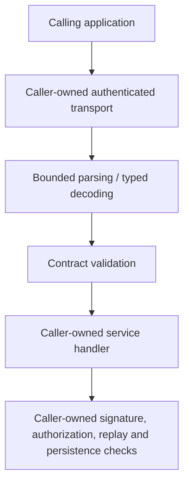

# Architecture

## Purpose

`protocol-contracts` provides typed Rust structures and local validation for a set of versioned wire formats. Modules are intentionally separated by protocol family; this crate does not add a common transport or runtime.

A successful validator result means only that the data conforms to the checked structural and binding rules. Authentication, authorization, evidence verification, nonce consumption, and external side effects stay outside the crate.

## Module map

| Module | Responsibility | Important exclusion |
|---|---|---|
| `lib.rs` | Legacy agent-message v1 types, bounded envelope decoder, field validation. | No socket, authentication, dispatch, or job store. |
| `agg_checkpoint_v2.rs` | Strict JSON parser, duplicate-key and numeric checks, canonicalization, domain digest. | A digest is not a signature or external checkpoint custody. |
| `evidence_resolution_v1.rs` | Evidence source request/response, URI constraints, byte limits, digest and declared producer-lineage binding. | Does not fetch URIs, authenticate peers, or independently verify producer history. |
| `evidence_verification_v1.rs` | Evidence subject/receipt schema, exact snapshot binding, freshness, stable IDs. | Does not verify Ed25519 signatures, trust roots, or nonce use. |
| `governance_v1.rs` | Approval request/receipt data, exact subject and audience binding, reviewer metadata, time windows. | Does not validate the receipt authenticator or decide authorization. |
| `mcp_service_v1.rs` | Transport-neutral MCP service request/response data, operation/effect constraints and idempotency metadata. | Does not authenticate principal assertions, implement gateway filtering, or enforce service authorization. |

## Dependency boundary

Runtime dependencies: `chrono`, `hex`, `serde`, `serde_json`, `sha2`, and `thiserror`. No sibling package, database, network, provider, or host-application dependency is required.

## Security invariants

- Closed structs reject unknown fields where declared with `deny_unknown_fields`.
- Parsers enforce protocol-specific encoded size, depth, node-count, timestamp, and value limits.
- Request/response validators compare exact request identities, audiences, subjects, digests, and expected peer identifiers where applicable.
- Mutation contracts require stable idempotency metadata; ambiguity is represented explicitly where the contract supports it.
- Canonicalization and hashes provide deterministic identity, not authenticity.
- Expected identities must come from the authenticated caller context, never from untrusted response fields.

## Protocol compatibility

The crate retains source protocol identifiers and version constants as wire-level data. Generic repository/package naming does not authorize changing those values. A wire-breaking change requires a distinct version or an explicit compatibility decision and updated cross-language vectors.
